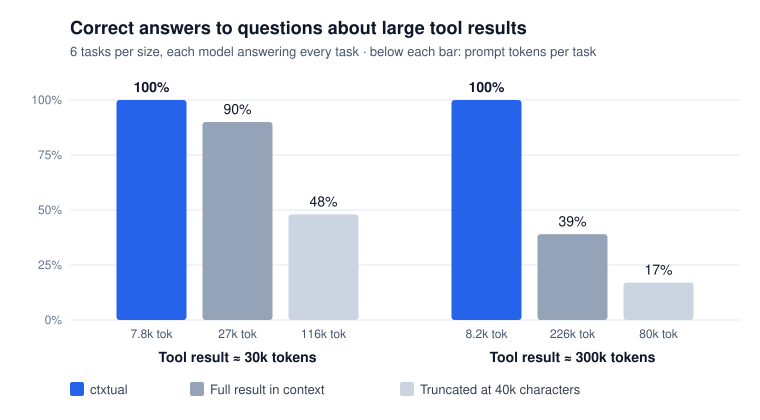

# Benchmark results

*October 2026 · ctxtual 0.5.1 · models served through OpenRouter*



An agent calls a tool, the tool returns a large result, and the agent must
answer a question that depends on it: count matching issues, find one
sentence among two thousand, read a fact from the middle of a manual, find
the service with the most errors. Each question has one exact answer.

We ran every question three ways, against the same MCP server:

- **ctxtual**: the server is wrapped with `Offload()` at its defaults. The
  model receives a short notice and the `result_*` tools.
- **Full result in context**: the result goes into the conversation whole,
  as most MCP clients do.
- **Truncated**: the result is cut at 40,000 characters, as clients with an
  output limit do.

## Findings

**Accuracy holds as results grow.** Through ctxtual, the models answered
every question correctly, 53 of 53, with results of 30k and of 300k tokens.
With the full result in context, accuracy fell from 90% to 39% as the result
grew: the models miscounted inside long prompts (92 MIT-licensed dependencies
instead of 1,284; 40 matching issues instead of 95), named the wrong service,
or could not take the result at all because it exceeded their context window.

**The cost stays flat.** A question answered through ctxtual took about
8,000 prompt tokens whatever the size of the result: 3.4× fewer than the
full result at 30k tokens, and 27× fewer at 300k. The difference compounds
in a real session, where a result placed in the context is sent again with
every later request, while a stored result costs nothing until it is used.

**Truncation is the worst of both.** Cut results were answered correctly
48% and 17% of the time. Models either answered from the part they could
see, or kept calling the tool to find the rest, re-sending large prompts on
every turn (DeepSeek averaged 335k prompt tokens per question this way).

**Small models can use it.** LFM 2.5, a 2.6-billion-parameter model,
answered all six questions correctly through ctxtual, at the same cost as
the larger models. The result tools accept the calls small models actually
make: argument aliases, operations written next to `steps`, steps in
`{"operation": ..., "params": ...}` form, `group_by` given a bare field name,
and `"none"` for an empty value.

ctxtual answered with about 2.5 tool calls per question: one call to the
original tool, then one or two searches or queries on the stored result.

## Results by model

Correct answers, and mean prompt tokens per question.

**Tool result ≈ 30k tokens** (120,000 characters)

| Model | ctxtual | Full result | Truncated |
|---|---|---|---|
| GLM 5.3 Flash (2 runs) | **12/12** · 6.7k | 11/12 · 23k | 6/12 · 29k |
| DeepSeek V4.1 Flash | **6/6** · 8.4k | 6/6 · 25k | 3/5 · 335k |
| Nemotron 3.5 Lightning | **6/6** · 8.4k | 4/6 · 27k | 2/6 · 14k |
| Flint v1.0 | **6/6** · 9.2k | 6/6 · 37k | 3/6 · 208k |
| **All** | **30/30 (100%)** · 7.8k | 27/30 (90%) · 27k | 14/29 (48%) · 116k |

**Tool result ≈ 300k tokens** (1.2 million characters)

| Model | ctxtual | Full result | Truncated |
|---|---|---|---|
| GLM 5.3 Flash (2 runs) | **12/12** · 7.1k | 6/12 · 228k | 2/12 · 63k |
| Nemotron 3.5 Lightning | **6/6** · 7.7k | 3/6 · 258k | 1/6 · 14k |
| Flint v1.0 | **5/5** · 11.6k | 0/5 · exceeds context in 3 of 5 | 1/6 · 180k |
| **All** | **23/23 (100%)** · 8.2k | 9/23 (39%) · 226k | 4/24 (17%) · 80k |

**Small model, tool result ≈ 30k tokens**

| Model | ctxtual |
|---|---|
| LFM 2.5 (2.6B) | **6/6** · 8.7k |

## The questions

| Task | Tool result | The question needs |
|---|---|---|
| `issues_count` | GitHub-style issues (JSON) | filtering on three fields and counting |
| `issues_needle` | the same issues | finding one sentence in one issue body |
| `issues_top` | the same issues | sorting: the open issue with the most comments |
| `docs_fact` | a long markdown manual | a fact in a section in the middle |
| `logs_errors` | service logs (JSON Lines) | grouping and counting by service |
| `deps_mit` | a dependency map (name → details) | counting entries by license |

The data is generated from fixed seeds, so every model and condition sees
the same results. The 300k-token versions have ten times as many items as
the 30k-token versions; the questions stay the same.

## Method

- **Agent loop.** Each run starts a fresh MCP server and session. The model
  receives a short system prompt (with the server's instructions, as clients
  pass them), the question, and the server's tools. It may call tools for up
  to 15 turns and must end with a line `ANSWER: …`.
- **Grading.** An answer is correct when it gives the expected number, or
  contains the expected text without naming another candidate. A model that
  omits the `ANSWER:` line is graded on its final reply. A run without an
  answer is incorrect.
- **Failures.** A result that exceeds the model's context window counts as
  incorrect: that is what a user gets. Runs that failed for infrastructure
  reasons, such as a provider timeout, are left out, in every condition
  alike; the tables show how many runs each cell is based on.
- **Settings.** ctxtual runs with `Offload()` defaults (results over 20,000
  characters stored). Truncation keeps the first 40,000 characters and says
  how many were cut. Models run through OpenRouter with their default
  sampling settings.
- **Data.** Every run (answer, tool calls with their arguments, turns,
  tokens, time) is in [`data/2026-10/`](data/2026-10/).

## Reproducing

```bash
export OPENROUTER_API_KEY=...
uv run --extra mcp python benchmarks/run.py \
    --models z-ai/glm-5.3-flash nvidia/nemotron-3.5-lightning:free \
    --sizes medium large --cheapest

# Grade saved runs again, without calling any model
uv run --extra mcp python benchmarks/run.py --report benchmarks/data/2026-10/*.jsonl
```

See [README.md](README.md) for every option.
